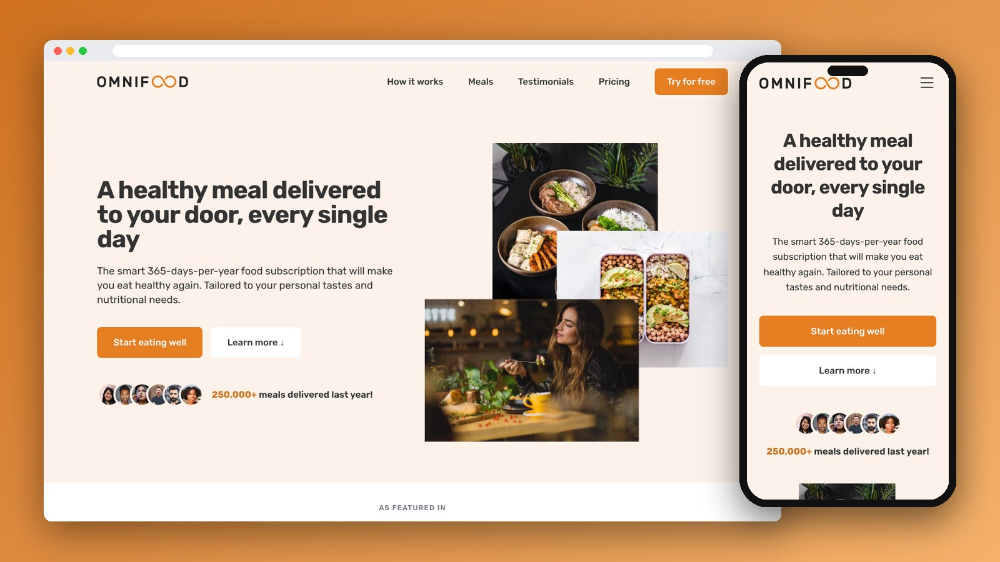

<div align="center">

# Omnifood

A landing page for an AI-powered healthy food subscription, rebuilt with Tailwind CSS and bug-fixed.

[](https://mo7-adad.github.io/omnifood/)

    

</div>

---



## Features

- Sticky header with a working mobile menu
- How it works, meals, testimonials + gallery, pricing and sign-up sections
- Custom Tailwind theme colors
- Smooth scrolling between sections
- Sign-up form with a thank-you message
- Fixed bugs from the original version (broken mobile menu, empty pricing item, wrong contact links)

## Project Structure

```
omnifood/
├── index.html
└── images/
```

## Run Locally

```bash
git clone https://github.com/mo7-adad/omnifood.git
cd omnifood
```

Then open `index.html` in your browser, or right-click it in VS Code and choose **Open with Live Server**.

## Author

**Mohamed Elhadad** — Front-End Developer

[](https://github.com/mo7-adad)
